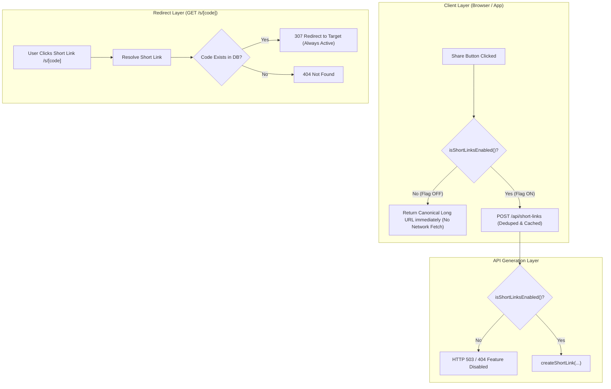

# Short Links Feature Flag & Safe Rollout Specification

Comprehensive specification for gating, developing, testing, deploying, and safely rolling out the Short Links subsystem using a zero-risk Feature Flag strategy.

---

## 1. Viability Assessment: Why a Feature Flag is Ideal

Implementing Short Links behind a feature flag is **100% viable and strongly recommended**.

### Key Architectural Factors:
1. **Decoupled Client Fallback (Zero Regression Risk)**:
   - The short link client utility (`getOrFetchShortUrl`) has a native fallback to canonical long URLs.
   - When the flag is disabled (`NEXT_PUBLIC_FEATURE_SHORT_LINKS=off`), the client simply bypasses network shortening and returns canonical URLs (`/spots/xyz`), rendering standard Version 5 QR codes ($37 \times 37$).
   - When the flag is enabled (`NEXT_PUBLIC_FEATURE_SHORT_LINKS=on`), the client resolves short links (`/s/7xK9q2A`) and renders optimized Version 2 QR codes ($25 \times 25$).
   - Existing share buttons (`ShareActions.tsx`, `SpotDetailsActions.tsx`, `MapInfoPopup.tsx`, `TvPlayerModal.tsx`) never break or throw errors under either state.
2. **Independent Database Schema**:
   - The `short_links` table has no incoming or outgoing foreign keys to core entities (it maps `code` to `target_url text`).
   - The database migration (`0002_short_links.sql`) can be applied days before feature activation with zero impact on production traffic.
3. **Instant Production Kill-Switch**:
   - If an unexpected upstream issue occurs (e.g., Supabase connection spike or edge misconfiguration), toggling `NEXT_PUBLIC_FEATURE_SHORT_LINKS=off` in Vercel immediately halts all generation requests within seconds without rolling back code.

---

## 2. Configuration & Flag Semantics

### 2.1 Environment Variable Definition
The feature is controlled by a single unified environment variable declared in `.env.example`:

```bash
# Short links generation and client UI upgrade.
# Values: "on" | "off" (default: "off" during rollout phase).
NEXT_PUBLIC_FEATURE_SHORT_LINKS=off
```

### 2.2 Centralized Feature Detection Helper
Located at `src/lib/config/feature-flags.ts`:

```ts
/**
 * Returns true if the Short Links subsystem is active.
 * Checked on both client (share buttons, QR generation) and server (API routes).
 */
export function isShortLinksEnabled(): boolean {
  const val = process.env.NEXT_PUBLIC_FEATURE_SHORT_LINKS?.trim().toLowerCase();
  return val === "on" || val === "true" || val === "1";
}
```

---

## 3. Layer-by-Layer Gating Matrix



| Layer | Component | Behavior when Flag is OFF (`off`) | Behavior when Flag is ON (`on`) |
| :--- | :--- | :--- | :--- |
| **Client Memory Cache** | `src/lib/utils/short-url.ts` | Bypasses network request entirely. Returns canonical long URL synchronously. | Invokes in-memory dedup fetcher to `/api/short-links`. Upgrades URL and QR code. |
| **Share Actions UI** | `src/components/ui/ShareActions.tsx` | Renders standard long URL QR code ($37 \times 37$). Copies long URL. | Renders compact short QR code ($25 \times 25$). Copies short URL. |
| **Creation API** | `src/app/api/short-links/route.ts` | Returns `503 Service Unavailable` with `{ error: "Short links disabled" }`. | Validates payload, deduplicates, and creates short link. |
| **Redirect Route** | `src/app/s/[code]/route.ts` | **Remains Active for Existing Links**: Resolves existing codes and redirects. | Resolves codes and redirects. |
| **Application Proxy** | `src/proxy.ts` | `/s/*` remains in `isProxyBypassPath` so any existing links remain cacheable. | `/s/*` in `isProxyBypassPath`, `/api/short-links` rate-limited. |

> [!IMPORTANT]
> **Asymmetric Gating Strategy**:
> `POST /api/short-links` (creation) is gated by `isShortLinksEnabled()`.
> `GET /s/[code]` (redirection) remains **active** even if creation is disabled. This guarantees that once a link is shared publicly (e.g. on social media or printed QR code), disabling creation will **never break existing links**.

---

## 4. Phased Rollout Plan

### Phase 0: Schema & Dark Deployment
1. Apply `0002_short_links.sql` migration to database (`pnpm db:apply`).
2. Deploy backend, services, API routes, and client utilities with `NEXT_PUBLIC_FEATURE_SHORT_LINKS=off`.
3. Verify that zero network calls are made to `/api/short-links` and all share actions continue functioning with long URLs.

### Phase 1: Preview & Staging Verification
1. Enable `NEXT_PUBLIC_FEATURE_SHORT_LINKS=on` in Vercel Preview environments (`.env.local` / preview branches).
2. Validate:
   - Short link creation and deduplication.
   - 307 redirects with sub-10ms response times and edge surrogate caching (`s-maxage=86400`).
   - Absence of `Set-Cookie` in `/s/[code]` responses.
   - Mobile camera scanning of Version 2 QR codes.
   - Offline fallback behavior when network is disconnected.

### Phase 2: Production Soft Launch
1. Set `NEXT_PUBLIC_FEATURE_SHORT_LINKS=on` in Vercel Production Environment Variables.
2. Monitor Vercel Edge request metrics and Supabase connection pool for 24 hours.

### Phase 3: Emergency Kill-Switch Protocol
If database pool saturation, edge anomalies, or unexpected errors occur:
1. Set `NEXT_PUBLIC_FEATURE_SHORT_LINKS=off` in Vercel Project Settings.
2. Trigger instant environment redeployment (takes $<30$ seconds).
3. Client instantly reverts to canonical long URLs. Existing short links remain resolvable.

### Phase 4: Graduation & Cleanup
After 30 days of stable production operation:
1. Remove `isShortLinksEnabled()` checks and adopt short links as default permanent behavior.
2. Deprecate `NEXT_PUBLIC_FEATURE_SHORT_LINKS` environment variable.

---

## 5. Automated Testing for Feature Flagging

Automated test suites must test both flag states to prevent regressions:

1. **`src/lib/utils/short-url.test.ts`**:
   - `when flag is off`: Verifies `getOrFetchShortUrl` returns long URL synchronously without calling `fetch`.
   - `when flag is on`: Verifies `getOrFetchShortUrl` calls `/api/short-links` and returns short URL.
2. **`src/app/api/short-links/route.test.ts`**:
   - `when flag is off`: Returns 503 response.
   - `when flag is on`: Returns 200/201 with short link payload.
3. **`src/components/ui/ShareActions.test.tsx`**:
   - `when flag is off`: Renders QR code matching long URL.
   - `when flag is on`: Upgrades QR code and clipboard value to short URL.
