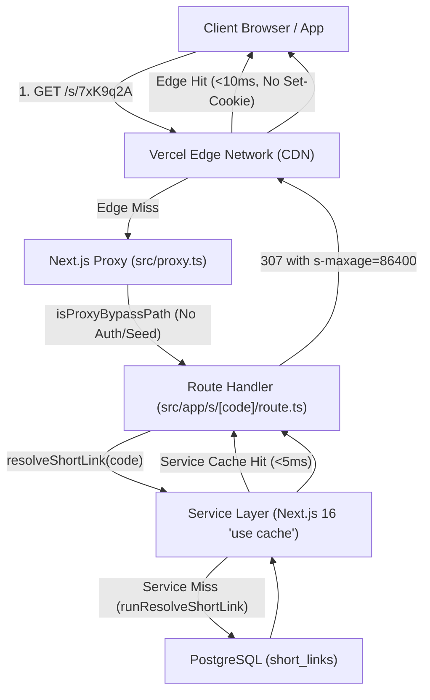

# Short Links System Specification

Comprehensive architectural and engineering specification for same-domain, high-performance, low-cost short URL generation and edge-cached redirection across the OpenSpot platform (Next.js 16 App Router, Node 22, Drizzle ORM, Supabase Postgres).

---

## 1. Executive Summary & Design Goals

The Short Links subsystem provides a unified, lightweight URL shortener for all shareable content in OpenSpot (spots, sport events, challenge games, TV clips, user profiles, and map views). For the phased rollout and kill-switch architecture, see [Feature Flag Specification](./feature-flag.spec.md).

### Primary Invariants
1. **Same-Domain Operation**:
   - Short links use the `/s/[code]` path prefix on the same primary domain (e.g., `https://openspotleague.com/s/7xK9q2A`).
   - Using `/s/` prevents routing ambiguity and avoids collision with existing and future Next.js App Router root paths (`/spots`, `/events`, `/games`, `/tv`, `/api`, `/admin`, `/login`, `/profile`, `/map`, `/robots.txt`, `/sitemap.xml`, etc.).
2. **Sub-10ms Edge CDN Redirects (Zero-Write Redirect Path)**:
   - Redirect requests (`GET /s/[code]`) return `307 Temporary Redirect` with edge surrogate caching:
     ```http
     Cache-Control: public, max-age=3600, s-maxage=86400, stale-while-revalidate=604800
     ```
   - Global CDN edges (Vercel Edge Network) cache the 307 response for 24 hours. Subsequent clicks worldwide are resolved at edge locations with **0 database queries**, $<10\text{ms}$ latency, and $\$0$ database compute egress.
   - **Zero Synchronous Writes on Read**: Unlike legacy shorteners that execute `UPDATE short_links SET clicks = clicks + 1` synchronously on every click, OpenSpot deliberately decouples redirection from telemetry to maintain pure CDN cacheability and protect Postgres connection pools.
   - **Set-Cookie Free Redirection**: Edge CDN caching requires responses to omit `Set-Cookie`. The proxy explicitly bypasses Supabase session verification for `/s/*` to guarantee cache eligibility.
3. **Storage & Cost Minimization via Target URL Deduplication**:
   - `target_url` carries a unique database index.
   - Repeated shares of the same spot, event, or view reuse the existing short code rather than allocating new database rows.
   - Storage footprint is bounded ($<150\text{ bytes}$ per row). 10,000 unique shared destinations consume $<1.5\text{MB}$ in Postgres.
4. **Resilient Client UX & Offline Fallback**:
   - Generating short links is non-blocking. If a user is offline or the network API experiences transient latency, the UI instantly defaults to the canonical long URL. Zero broken shares.
   - In-memory Promise deduplication guarantees that concurrent share widgets on the same page trigger at most one network request.
5. **Enhanced Mobile QR Code Scanning**:
   - Short URLs reduce QR string length from $\sim 75$ characters to $\sim 33$ characters.
   - Reduces QR matrix complexity from Version 5 ($37 \times 37$ modules) down to Version 2 ($25 \times 25$ modules), cutting module density by $>50\%$.
   - Mobile camera scanners acquire and decode the QR code substantially faster, especially in low-light outdoor environments.

---

## 2. URL Structure, Base62 Encoding & Normalization

### 2.1 Code Alphabet & Space
- **Alphabet**: URL-safe Base62: `[0-9a-zA-Z]` (62 discrete characters).
- **Default Length**: 7 characters (e.g. `7xK9q2A`).
- **Generation Entropy**: Cryptographically secure uniform distribution via rejection sampling over 256-byte values ($256 - (256 \pmod{62}) = 248$, discarding bytes $\ge 248$) to eliminate modulo bias.
- **Combinatorial Space**:
  $$62^7 = 3,521,614,606,208 \text{ combinations (3.52 trillion)}$$
- **Collision Probability**:
  At 1,000,000 active unique destinations, collision chance is $< 0.000014\%$. On the off-chance of collision, the creation service retries with backoff up to 3 attempts.
- **Allowed Code Validation Pattern**: `^[a-zA-Z0-9]{4,16}$`.

### 2.2 Canonical URL Normalization & Validation
To prevent duplicate rows for functionally identical destinations and ensure security:
1. **Absolute URL Stripping**: Absolute URLs matching the application domain (`env.APP_URL`, `localhost`, `*.vercel.app`, `openspotleague.com`) are stripped to canonical relative paths (`pathname + search + hash`).
2. **Trailing Slash Removal**: Trailing slashes on paths (`/spots/spot-1/` $\rightarrow$ `/spots/spot-1`) are stripped, unless root `/`.
3. **Query Parameter Sorting**: Query parameters are canonically ordered via `URLSearchParams.sort()` so `/map?spot=1&zoom=15` and `/map?zoom=15&spot=1` map to the identical short link.
4. **Recursion Guard**:
   - Reject any string starting with `/s/` or `/s` (returns HTTP 400).
   - Prevents recursive redirection chains (`/s/a -> /s/b`) and self-referential loops.
5. **Internal Infrastructure Route Block**:
   - Reject any string starting with `/api/`, `/_next/`, or `/admin/` (returns HTTP 400).
   - Short links may only point to user-facing content views (`/spots/*`, `/events/*`, `/games/*`, `/tv*`, `/profile*`, `/map*`, `/league*`, etc.).
6. **Protocol-Relative & Open Redirect Guards**:
   - Reject any string starting with `//` (protocol-relative phishing attack).
   - Reject any string with non-http/https protocol (`javascript:`, `data:`, `file:`).
   - Reject any string containing ASCII control characters or newlines (`[\u0000-\u001F\u007F]`).
   - Reject any external domain destination (returns HTTP 400).

---

## 3. Data Model & Database Architecture

### 3.1 PostgreSQL Schema (`short_links`)
Defined physically in `src/db/schema/index.ts` using Drizzle ORM and migrated via `supabase/migrations/0002_short_links.sql`:

```ts
export const shortLinks = pgTable(
  "short_links",
  {
    id: uuid("id").primaryKey().defaultRandom(),
    code: text("code").notNull(),
    targetUrl: text("target_url").notNull(),
    title: text("title"),
    createdAt: timestamp("created_at", { withTimezone: true, precision: 3 })
      .notNull()
      .defaultNow(),
    updatedAt: timestamp("updated_at", { withTimezone: true, precision: 3 })
      .notNull()
      .defaultNow(),
  },
  (t) => [
    uniqueIndex("short_links_code_idx").on(t.code),
    uniqueIndex("short_links_target_url_idx").on(t.targetUrl),
    check("short_links_code_check", sql`length(${t.code}) >= 4 and length(${t.code}) <= 32`),
    check("short_links_target_url_check", sql`length(${t.targetUrl}) > 0 and length(${t.targetUrl}) <= 2048`),
  ],
);

export type ShortLink = typeof shortLinks.$inferSelect;
export type NewShortLink = typeof shortLinks.$inferInsert;
```

Equivalent SQL DDL in migration ledger:
```sql
CREATE TABLE IF NOT EXISTS "short_links" (
    "id" uuid PRIMARY KEY DEFAULT gen_random_uuid() NOT NULL,
    "code" text NOT NULL,
    "target_url" text NOT NULL,
    "title" text,
    "created_at" timestamp(3) with time zone DEFAULT now() NOT NULL,
    "updated_at" timestamp(3) with time zone DEFAULT now() NOT NULL,
    CONSTRAINT "short_links_code_check" CHECK (length("short_links"."code") >= 4 AND length("short_links"."code") <= 32),
    CONSTRAINT "short_links_target_url_check" CHECK (length("short_links"."target_url") > 0 AND length("short_links"."target_url") <= 2048)
);

CREATE UNIQUE INDEX IF NOT EXISTS "short_links_code_idx" ON "short_links" USING btree ("code");
CREATE UNIQUE INDEX IF NOT EXISTS "short_links_target_url_idx" ON "short_links" USING btree ("target_url");
```

### 3.2 Index Strategy & Concurrency
- `short_links_code_idx`: B-Tree index providing $O(1)$ lookups on redirect resolution.
- `short_links_target_url_idx`: B-Tree index providing $O(1)$ lookups for deduplication during creation.
- **Race Condition Handling**:
  If two concurrent requests attempt to shorten the same new destination simultaneously, Postgres enforces uniqueness via `short_links_target_url_idx`. The service catches the constraint violation (`23505`) and re-queries `findByTargetUrl`, returning the race winner's record seamlessly.

---

## 4. Multi-Layer Caching Architecture



### 4.1 Edge CDN Layer & Next.js 16 Route Handler
- Route handler `src/app/s/[code]/route.ts` implements Next.js 16 async route parameters:
  ```ts
  export async function GET(
    _request: NextRequest,
    context: { params: Promise<{ code: string }> },
  ): Promise<Response>
  ```
- **Redirect Response**:
  `Cache-Control: public, max-age=3600, s-maxage=86400, stale-while-revalidate=604800`
  - `s-maxage=86400`: Instructs the CDN edge cache to keep the 307 response hot for 24 hours.
  - `max-age=3600`: Client browsers cache the redirect for 1 hour. We intentionally avoid permanent `301/308` headers to prevent permanent client-side disk poisoning in case a link target is updated.
  - `stale-while-revalidate=604800`: Edge serves stale responses while refreshing asynchronously if expired.
- **Not Found (404)**: Returns 404 response with `Cache-Control: public, max-age=60, s-maxage=300` to prevent origin database hammering on repeated invalid lookups.
- **Invalid Format**: Invalid codes (failing `isValidShortCode`) immediately return a 302 redirect to `/` with no database lookup.

### 4.2 Application Proxy (`src/proxy.ts`)
1. **Anonymous Bypass (`isProxyBypassPath`)**:
   - `/s` and paths starting with `/s/` are added to `isProxyBypassPath`:
     ```ts
     if (pathname === "/s" || pathname.startsWith("/s/")) return true;
     ```
   - Skips Supabase `auth.getClaims()` session token verification and seed generation.
   - **Crucial Invariant**: Keeping `/s/*` responses strictly `Set-Cookie`-free is an absolute prerequisite for CDN edge caching on Vercel.
2. **Creation Endpoint Rate Limiting**:
   - `POST /api/short-links` is protected in `RATE_LIMIT_TIERS`:
     ```ts
     { match: (p) => p.startsWith("/api/short-links"), limit: 30, tag: "short-links" }
     ```
   - Sliding window IP rate limiter (30 requests/minute per IP) prevents automated enumeration and brute-force generation.

### 4.3 Service Layer (`"use cache"`)
- `resolveShortLink` uses Next.js 16 `"use cache"` boundary:
  ```ts
  "use cache";
  cacheTag(`short-link:${code}`);
  cacheLife(SHORT_LINK_CACHE_LIFE);
  ```
- `SHORT_LINK_CACHE_LIFE` is centralized in `src/lib/cache/lifetimes.ts`:
  ```ts
  export const SHORT_LINK_CACHE_LIFE = { revalidate: 86400, stale: 604800, expire: 2592000 } as const;
  ```
  *(Next.js 16 requires the exact profile object reference for `cacheLife` and `revalidateTag`)*.
- Write operations run inside `withDbWrite` (`src/lib/db/client.ts`), which automatically executes within `runWithDeferredCacheInvalidation`. If a short link is created or modified, `queueTagRevalidate` flushes after the transaction commits.

### 4.4 Client-Side Memory Cache
- `src/lib/utils/short-url.ts` maintains an in-memory `Map<string, Promise<string>>`.
- `getOrFetchShortUrl(url: string, title?: string): Promise<string>`:
  - If the URL is already short (`/s/...`), returns it immediately.
  - If offline (`!navigator.onLine`), returns the canonical long URL immediately.
  - Shares in-flight promises across concurrent callers on the same page.
  - Catches transient network errors and falls back to the canonical long URL (zero broken shares).

---

## 5. Security & Rate Limiting

1. **Anti-Phishing / Open-Redirect Defense**:
   - `normalizeTargetUrl` validates that redirects stay strictly within internal relative routes (`/spots/*`, `/events/*`, etc.).
   - External domains (e.g. `https://malicious.example.com`) are rejected with HTTP 400.
2. **Anti-Recursion Defense**:
   - Any attempt to shorten a target starting with `/s/` or `/s` is rejected with HTTP 400.
3. **Internal Route Protection**:
   - Targets pointing to `/api/*`, `/_next/*`, or `/admin/*` are rejected with HTTP 400.
4. **API Rate Limiting**:
   - `POST /api/short-links` is rate-limited to 30 requests per minute per IP via `src/proxy.ts`.
5. **Input Sanitization**:
   - `code` parameter must match `/^[a-zA-Z0-9]{4,16}$/`. Invalid codes immediately redirect to `/` without executing any database query.
   - Target URL is capped at 2,048 characters to eliminate payload bloat.

---

## 6. Social Crawlers & Open Graph Previews

When a short link is posted on WhatsApp, iMessage, Twitter/X, Discord, Slack, or Facebook:
1. The platform crawler sends a `GET` / `HEAD` request to `https://openspotleague.com/s/[code]`.
2. The endpoint responds with `307 Location: https://openspotleague.com/spots/[id]`.
3. Standard social crawlers follow the 307 redirect to the target page.
4. The target page (`/spots/[id]`, `/events/[id]`, `/tv`, etc.) executes its existing `generateMetadata` and `opengraph-image.tsx`, rendering rich preview cards (spot photos, discipline tags, live weather, map preview) seamlessly.

---

## 7. Frontend Integration Matrix

| Surface | File Path | Interaction | Behavior |
| :--- | :--- | :--- | :--- |
| **Share Sheet / Actions** | `src/components/ui/ShareActions.tsx` | Share, Copy Link, QR Code | Calls `getOrFetchShortUrl` on mount / URL change. Renders crisp short QR code ($25 \times 25$). Copies/shares short URL. Falls back instantly to canonical long URL if offline or in-flight. |
| **Spot Detail Actions** | `src/components/spots/detail/SpotDetailsActions.tsx` | "Share" pill button | Calls `getOrFetchShortUrl('/spots/' + spot.id)` and native `shareOrCopyUrl`. |
| **Map Popup Pin** | `src/components/map/panels/MapInfoPopup.tsx` | Share icon button | Resolves short URL for active pin and triggers native share sheet or clipboard. |
| **OpenSpot TV Theater** | `src/components/tv/player/TvPlayerModal.tsx` | Share icon button | Resolves short URL for `buildTvSharePath(video.id)` and triggers share or copy. |
| **Sport Events & League** | `src/components/map/panels/EventPanel.tsx` | ShareActions component | Inherits short link generation and QR enhancement via `ShareActions`. |
| **Challenge Games** | `ChallengeStartCountdownDialog.tsx` & `header-parts.tsx` | ShareActions component | Shares crew code and short join link `/games/join/[code]`. |

---

## 8. Verification & Test Suite

### 8.1 Automated Test Coverage
- **`src/lib/utils/short-code.test.ts`**:
  - Base62 format correctness, cryptographic entropy distribution, length bounds.
  - URL normalization (same-origin extraction, trailing slash removal, query parameter sorting).
  - Open redirect blocking, protocol validation, recursion guard (`/s/*`), and internal route protection (`/api/*`).
- **`src/lib/repositories/short-link/drizzle-short-link-repository.test.ts`**:
  - Repository mock DB chain for `findByCode`, `findByTargetUrl`, `create`.
  - Handling of unique constraint violation errors (`23505`).
- **`src/lib/services/short-link/short-links.test.ts`**:
  - Cache integration (`"use cache"`), target URL deduplication, collision retry handling, and concurrency race recovery.
- **`src/app/api/short-links/route.test.ts`**:
  - POST payload parsing, Zod validation, origin detection, error responses.
- **`src/app/s/[code]/route.test.ts`**:
  - 307 redirect responses, Location header format, `Cache-Control` presence, 404/expired handling, and invalid code 302 redirect.
- **`src/proxy.test.ts`**:
  - `isProxyBypassPath` for `/s/...` and rate limit tier matching for `/api/short-links`.
- **`src/components/ui/ShareActions.test.tsx`**:
  - UI rendering, initial fallback, short URL upgrade, QR code SVG value propagation, and clipboard copy.

### 8.2 Execution Commands
```bash
# Unit & integration test execution
node ./node_modules/vitest/vitest.mjs run \
  src/lib/utils/short-code.test.ts \
  src/lib/repositories/short-link/drizzle-short-link-repository.test.ts \
  src/lib/services/short-link/short-links.test.ts \
  src/app/api/short-links/route.test.ts \
  src/app/s/\[code\]/route.test.ts \
  src/proxy.test.ts \
  src/components/ui/ShareActions.test.tsx

# Full project typecheck
node ./node_modules/typescript/bin/tsc --noEmit
```
