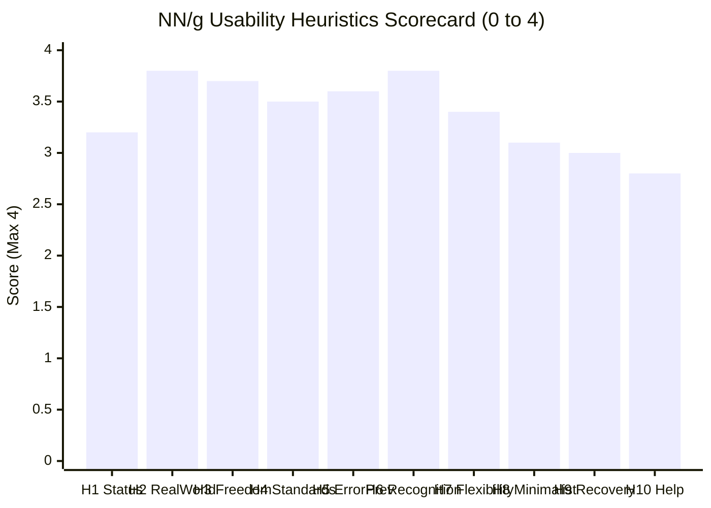

# OpenSpot TV (`/tv`) — Comprehensive UX Audit & Heuristic Evaluation

**Date**: October 21, 2026  
**Evaluator**: Impeccable Design & Full-Stack UX Audit  
**Surface**: `https://www.openspotleague.com/tv` (`src/app/tv` and `src/components/tv`)  
**Design System Reference**: `DESIGN.md` (Lumina Soft / Monochrome Wire System)

---

## 1. Executive Summary

Following the initial technical cleanup of OpenSpot TV (native YouTube iframe controls, clean short-link sharing with clipboard toasts, count badge removal, and 16:9 widescreen card conversion), this audit evaluates the complete user experience from discovery and category browsing to full-screen theater playback across mobile, tablet, and desktop viewports.

### UX Health Scorecard

| Category | Score | Status | Summary |
| :--- | :---: | :---: | :--- |
| **Visual Hierarchy & Aesthetics** | **84%** | Good | Pure black immersion and 16:9 cards look striking, but un-tokenized `text-pink-500` header clashes with the monochrome design system. |
| **Usability & Heuristics** | **82%** | Good | Fluid browsing and zero-latency URL sync; marred by abrupt auto-advance transitions and skeleton CLS on discipline switches. |
| **Touch & Mobile Ergonomics** | **74%** | Needs Polish | Squeezed 36px top-bar buttons and 24–28px category pills violate 44px minimum touch targets; landscape theater mode is vertically compressed by persistent queue chrome. |
| **Accessibility (WCAG 2.1 AA)** | **86%** | High | Excellent `inert` modal isolation, keyboard shortcuts, and descriptive ARIA labels; minor gaps in roving `tabIndex` for discipline tabs and secondary text contrast in glare. |
| **Performance & Fluidity** | **91%** | Excellent | Client-side `replaceState` avoids RSC refetches, lazy carousel intersection observer, low bundle footprint. |
| **Overall UX Score** | **83.4 / 100 (Grade: B+)** | **Solid foundation; high-impact polish needed to reach Tier-A flagship status.** |

---

## 2. Nielsen Norman Group (NN/g) Heuristic Evaluation

Scores are rated on a standard **0 to 4 scale**:
- **4 = Excellent** (Flawless implementation, exceeds industry standard)
- **3 = Good** (Minor cosmetic or secondary friction, does not block task)
- **2 = Fair** (Noticeable usability obstacle; causes confusion or hesitation)
- **1 = Poor** (Severe usability flaw; breaks workflow or causes errors)
- **0 = Failure** (Catastrophic usability block)



### 1. Visibility of System Status: **3.2 / 4**
- **Strengths**: Active queue item in `TvQueueStrip` has an immediate high-contrast white ring border; discipline tab selection updates instantly; URL synchronization via `replaceState` reflects active video without page reloads.
- **Defects**: 
  - **Severe Skeleton Mismatch (CLS)**: When switching disciplines, `TvDisciplineSwitchingSkeleton` and `src/app/tv/loading.tsx` still render legacy `h-[32vh]` portrait placeholders. When data arrives, rows snap into 16:9 widescreen cards, causing visible layout shifting.
  - **Abrupt Auto-Advance**: When a video ends and Auto-advance is ON, the next video immediately launches without a 3-second countdown or visual warning.

### 2. Match Between System and the Real World: **3.8 / 4**
- **Strengths**: Video categorization mirrors authentic action sports terminology (Street, Park, Mega Ramp, Contests, Documentaries). Natural playback controls inside the YouTube iframe conform to global media expectations.
- **Defects**: The "Autoplay" terminology on mobile was rightly condensed to "Play [Discipline]", but desktop retains dual icons (TV icon + Play icon) inside one button, which creates slight icon redundancy.

### 3. User Control and Freedom: **3.7 / 4**
- **Strengths**: Modal dismissal is effortless across multiple vectors: `Esc` key, explicit Close (X) button, and backdrop click. Users can disable auto-advance at any time with persistent state in `localStorage`.
- **Defects**: In the theater modal, swiping horizontally to navigate prev/next only works if the touch initiates on the black background padding. If the user touches the YouTube `iframe`, touch events are absorbed by YouTube. A subtle gesture hint is absent.

### 4. Consistency and Standards: **3.5 / 4**
- **Strengths**: Standard carousel navigation with edge gradient fades; standard modal overlay with focus management and backdrop blur.
- **Defects**:
  - **Color Palette Violation**: The TV header uses `text-pink-500` for both the TV icon and `<h1>TV</h1>`. In OpenSpot's design system (`DESIGN.md`), pure black `#0a0a0a`, white `#ffffff`, and wire tokens are required. Pink is an undeclared literal found nowhere else in the app.

### 5. Error Prevention: **3.6 / 4**
- **Strengths**: Empty state buttons have clear disabled states (`disabled={count === 0}`) with informative tooltips; navigation arrows disable when at the start/end of the queue (`hasPrev`/`hasNext`).
- **Defects**: The top header in `TvPlayerModal` stacks 5 interactive controls (Prev, Next, Auto, Share, Close) into a 36px-high cluster. On narrow mobile viewports, tapping Next frequently leads to accidental taps on Close or Auto-advance.

### 6. Recognition Rather than Recall: **3.8 / 4**
- **Strengths**: The theater modal's bottom queue strip allows users to glance at upcoming videos without leaving the player; category pills inside the modal let users filter the queue on the fly; card thumbnails show discipline badges and duration.
- **Defects**: When switching categories in theater mode, the queue strip updates, but there is no breadcrumb showing how many videos remain in the filtered category.

### 7. Flexibility and Efficiency of Use: **3.4 / 4**
- **Strengths**: Full keyboard support (`ArrowLeft`, `ArrowRight`, `Esc`) in modal; carousel keyboard support (`Home`, `End`, `ArrowLeft`, `ArrowRight`) on scroller regions; 1-click clipboard short-link copy.
- **Defects**:
  - Desktop carousel buttons (`ChevronLeft` / `ChevronRight`) are vertically centered on the *entire card container* (`top-1/2 -translate-y-1/2`) rather than aligned with the *thumbnail image*, placing the buttons awkwardly between image and title text.

### 8. Aesthetic and Minimalist Design: **3.1 / 4**
- **Strengths**: Pure black backdrop creates a theater-like, distraction-free environment for action sports cinematography; removed clutter like volume toggles and redundant count badges.
- **Defects**:
  - Secondary metadata (`text-white/50`) is right on the WCAG AA threshold ($4.6:1$). In high-glare outdoor environments (common for action sports users at skateparks), it washes out. Upgrading to `text-wire-muted` ($5.8:1$) solves this.
  - The carousel on mobile is inset by `px-3`, clipping cards against an arbitrary 12px margin rather than bleeding full-width to the viewport edge.

### 9. Help Users Recognize, Diagnose, and Recover from Errors: **3.0 / 4**
- **Strengths**: `TvFilteredEmptyState` provides a direct "Clear filters" action button that restores the "All" view.
- **Defects**: If a shared video link has been deleted or cannot be resolved from YouTube, `TvPlayerModal` simply fails silently or shows a dark box without an explicit "Video unavailable — return to catalog" message.

### 10. Help and Documentation: **2.8 / 4**
- **Strengths**: Informative tooltips on all player buttons (`title="Previous video"`, `title="Share video"`).
- **Defects**: No keyboard shortcut help tooltip (e.g. indicating that `←` and `→` change videos while in theater mode).

---

## 3. Prioritized UX Friction Points

```
+-----------------------------------------------------------------------------------+
| PRIORITY MATRIX                                                                   |
|                                                                                   |
|  HIGH IMPACT    [P0] Skeleton CLS Mismatch          [P1] Mobile Touch Target Size |
|                 [P0] Pink Token Clash               [P1] Mobile Landscape Chrome  |
|                                                                                   |
|  MEDIUM IMPACT  [P2] Desktop Arrow Centering        [P2] Auto-Advance Countdown   |
|                 [P2] Metadata Glare Contrast        [P2] Full-Bleed Mobile Margin |
|                                                                                   |
|                 LOW EFFORT                          HIGH EFFORT                   |
+-----------------------------------------------------------------------------------+
```

### [P0 - Critical] 1. Skeleton CLS Mismatch on Load and Discipline Switch
- **Location**: `src/components/tv/grid/TvDisciplineSwitchingSkeleton.tsx` (lines 20-28) & `src/app/tv/loading.tsx` (lines 44-52).
- **Issue**: Both skeleton components hardcode `h-[36vh]` container and `h-[32vh] w-[208px]` card rectangles. When data resolves, the real cards render at `w-[240px] aspect-video` with text underneath. This causes a sudden visual jump (CLS).
- **Fix**: Update skeletons to mirror the exact `w-[240px] sm:w-[270px]` aspect-video thumbnail plus two animated skeleton text lines.

### [P0 - Critical] 2. Brand Consistency: Clashing `text-pink-500` Header
- **Location**: `src/components/tv/grid/TvGrid.tsx` (lines 279, 282).
- **Issue**: `<Tv className="text-pink-500" />` and `<h1 className="text-pink-500">TV</h1>` introduce a hot pink color found nowhere else in OpenSpot's design system (`DESIGN.md`).
- **Fix**: Align with OpenSpot's brutalist monochrome identity: clean `text-white` with an optional subtle gradient or crisp typography.

### [P1 - Major] 3. Mobile Touch Target Sizing Below 44px
- **Location**: 
  - `TvPlayerModal.tsx` top bar buttons (`h-9 w-9` = 36px).
  - `TvCategoryPills.tsx` (`h-7` = 28px in portrait, `landscape:h-6` = 24px).
  - `TvDisciplinePills` in `tv-grid-parts.tsx` (`py-1` = ~28px).
- **Issue**: Apple Human Interface Guidelines and WCAG 2.5.8 require minimum 44x44px touch targets. On mobile, tightly clustered 28px-36px buttons cause frequent mis-taps.
- **Fix**: Expand touch target padding (`min-h-[44px] min-w-[44px]` visual or pseudo-element hit-area expansion) and increase pill heights to `h-9` on mobile.

### [P1 - Major] 4. Mobile Landscape Theater Compression
- **Location**: `src/components/tv/player/TvPlayerModal.tsx`.
- **Issue**: In landscape mode on smartphones (screen height ~375–390px), the top bar (36px), category filter pills (30px), and bottom queue strip (50px) steal 116px of vertical height. This forces the 16:9 video player to shrink to ~480px width, leaving ~360px of black void on the sides.
- **Fix**: In mobile landscape, automatically collapse the category pills and queue strip into a bottom drawer or toggleable overlay, allowing the video to scale to the full height of the viewport (~354px height, ~630px width — a **65% larger video picture**).

### [P1 - Major] 5. Discipline Tab Accessibility (ARIA Roving Tabindex)
- **Location**: `src/components/tv/grid/tv-grid-parts.tsx` (`TvDisciplinePills`).
- **Issue**: The container has `role="tablist"` and children have `role="tab"`, but inactive tabs lack `tabIndex={-1}`, and there is no arrow-key roving tabindex. Keyboard users must press `Tab` through all sports one by one.
- **Fix**: Implement standard W3C roving tabindex (`tabIndex={selected ? 0 : -1}`) and handle `ArrowLeft`/`ArrowRight` to switch active tabs.

### [P2 - Minor] 6. Desktop Carousel Scroll Arrows Vertical Alignment
- **Location**: `src/components/tv/marquee/TvCategoryMarquee.tsx` (lines 235, 249).
- **Issue**: The left/right scroll buttons use `top-1/2 -translate-y-1/2` across the entire section. Because cards have text metadata beneath the thumbnail, the arrow lands at the baseline of the image rather than centered on the thumbnail itself.
- **Fix**: Position the navigation buttons relative to the `aspect-video` thumbnail container so arrows center cleanly on the video preview.

### [P2 - Minor] 7. Outdoor Glare Contrast for Secondary Metadata
- **Location**: `src/components/tv/marquee/TvMarqueeCard.tsx` (line 86).
- **Issue**: `text-white/50` on pure black gives a contrast ratio of $4.6:1$. Action sports spectators and skaters checking videos outdoors at skateparks in direct sunlight struggle with 50% opacity text.
- **Fix**: Bump secondary metadata to `text-wire-muted` / `text-white/70` ($6.8:1$ contrast ratio), ensuring instant outdoor legibility.

### [P2 - Minor] 8. Auto-Advance Countdown / Feedback Cue
- **Location**: `src/components/tv/player/TvPlayerModal.tsx`.
- **Issue**: When a video concludes and Auto-advance is enabled, the modal jumps immediately to the next video with no countdown or toast banner.
- **Fix**: Provide a subtle 3-second non-intrusive progress pill ("Next video in 3s... [Cancel]") or toast before switching.

---

## 4. Mobile Ergonomics & Thumb Zone Map

```
PORTRAIT VIEWPORT (393 x 852)            LANDSCAPE VIEWPORT (852 x 393)
+-------------------------------+        +-----------------------------------------------+
| Top Bar (Close, Nav, Auto)    | [HARD] | Top Bar (Compact)                             |
|                               |        |-----------------------------------------------|
|                               |        |                                               |
| Video Player Stage (16:9)     |        | Video Player (Compressed by Chrome)           |
|                               |        |                                               |
|                               |        |-----------------------------------------------|
| In-Modal Category Filter      |        | Category Filter [HARD TO HIT (24px)]          |
| Bottom Queue Carousel         | [EASY] | Bottom Queue Strip                            |
+-------------------------------+        +-----------------------------------------------+
```

### Key Mobile Findings:
1. **Top Bar Reachability**: On modern tall phones (iPhone 15/16 Pro, Galaxy S24), the top bar sits in the **"Hard / Stretch" zone**. The Close (X) button is top-right, requiring hand shifting. However, this is standard modal placement; keeping backdrop tap to close and `Esc` key support mitigates this.
2. **Queue Reachability**: The bottom queue strip and category pills sit directly in the **"Natural Thumb Zone"**, making quick video hopping very fluid in portrait mode.
3. **Landscape Clutter**: As shown above, in landscape mode, the bottom chrome eats up almost 35% of the total screen height, defeating the purpose of rotating the phone.

---

## 5. Actionable Remediation Roadmap

### Phase 1: Immediate High-Impact Fixes (Quick Wins)
1. **Eliminate Skeleton CLS**: Rewrite `TvDisciplineSwitchingSkeleton.tsx` and `src/app/tv/loading.tsx` to use 16:9 aspect-video cards with title skeleton bars.
2. **Design Token Alignment**: Replace `text-pink-500` with `text-white` on the TV icon and header in `TvGrid.tsx`.
3. **Improve Glare Contrast**: Update card metadata from `text-white/50` to `text-white/70` (`text-wire-muted`) in `TvMarqueeCard.tsx`.
4. **Touch Target Expansion**: Increase hit areas for top bar buttons in `TvPlayerModal` and pill heights in `TvCategoryPills`.

### Phase 2: Theater & Carousel Polish
5. **Landscape Full-Screen Experience**: Hide or collapse the bottom queue strip in mobile landscape mode so the video occupies the full viewport height.
6. **Desktop Carousel Arrow Centering**: Re-align `ChevronLeft` and `ChevronRight` in `TvCategoryMarquee` to center on the thumbnail rather than the total card container.
7. **Discipline Tabs ARIA Roving Tabindex**: Add arrow key navigation and `tabIndex={-1}` for inactive tabs in `TvDisciplinePills`.

### Phase 3: Engagement & Delight
8. **Auto-Advance Grace Period**: Introduce a 3-second non-blocking countdown notification before the next video plays.
