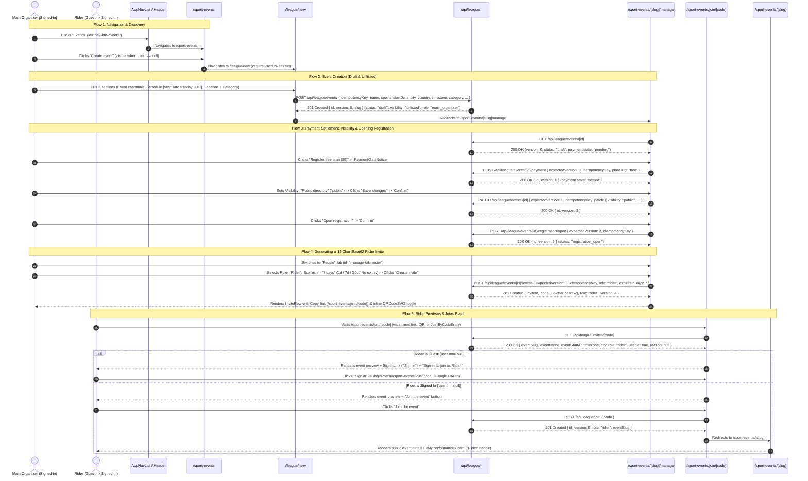

# OpenSpot League — Sport Events & League User Stories, Architecture & E2E Flow Report

> **Document:** `sports-events-us.md`
> **Status:** Verified & Aligned with Codebase Reality (Tier 3 Audit)
> **Target Routes:** `/sport-events`, `/league`, `/league/new`, `/sport-events/[slug]/manage`, `/sport-events/join/[code]`, `/sport-events/[slug]`
> **Date:** November 2026

---

## 1. Executive Summary

This document provides a ground-up, code-verified specification of the **Sport Events & League** competition subsystem in OpenSpot League, covering end-to-end user flows, domain invariants, user stories, acceptance criteria, and edge cases.

### System Map

| Surface / Layer | Route / File | Responsibility |
| :--- | :--- | :--- |
| **Global Navigation** | `src/lib/navigation/nav.ts`, `src/types/spots.ts` | Exposes `Events` (`CalendarDays`, `id="nav-btn-events"`) in desktop header, mobile bottom bar, and side drawer. |
| **Public Events Hub** | `/sport-events` (`SportEventsTab.tsx`) | Public event directory (`visibility = 'public'`), status filter (`all`, `live`, `upcoming`, `completed`), role-aware CTAs (`Create event`, `My league`), and compact `JoinByCodeEntry`. |
| **My League Hub** | `/league` (`LeagueHub.tsx`) | Auth-gated member dashboard grouping active memberships into `Organizing`, `Judging`, and `Riding` with payment-gate notices and link-variant `JoinByCodeEntry`. |
| **Create Event** | `/league/new` (`LeagueCreateForm.tsx`) | Auth-gated 3-section creation form submitting to `POST /api/league/events` with a client UUID `idempotencyKey`. |
| **Organizer Console** | `/sport-events/[slug]/manage` (`ManageConsole.tsx`) | Role-aware competition console with 5 tabs (`Event`, `People`, `Runs`, `Metrics`, `Results`), payment gate actions, lifecycle transitions, invite generation (link + QR), and live scoring. |
| **Invite Landing** | `/sport-events/join/[code]` (`JoinWithInvite.tsx`) | Public invite preview (`GET /api/league/invites/[code]`) + sign-in gate for guests + one-tap join (`POST /api/league/join`) for authenticated users. |
| **Public Event Detail** | `/sport-events/[slug]` (`src/app/sport-events/[slug]/page.tsx`) | Public detail page for `visibility = 'public'` events, including member-only `<MyPerformance>` card when the signed-in viewer has an active membership. |
| **Domain Engine** | `src/lib/league/definitions.ts`, `src/lib/league/engine.ts` | Pure state machine transitions, payment gate math, 2-month schedule window, role capabilities, base62 invite encoding, weighted scoring, and ranking/points calculation. |
| **Service Layer** | `src/lib/services/league/index.ts` | Drizzle transactional writers (`withDbWrite` + `lockEvent` row locks + `expectedVersion` OCC + `league_idempotency_keys` + `event_realtime_signals`). |

---

## 2. Critical Findings & Architectural Constraints

### 2.1 Authentication Provider Limitation

> [!WARNING]
> **Only Google OAuth Is Implemented**
> - `src/app/login/page.tsx` and `src/app/api/auth/signin/google/route.ts` (`signInWithGoogle` in `src/lib/auth/server.ts`) only implement **Google OAuth**.
> - There is no email/password, magic-link, or email OTP login form or route handler anywhere in `src/app/login` or `src/app/api/auth` (which contains only `session`, `signin/google`, and `signout`).
> - **Testing Implication:** Automated or headless browser E2E tests cannot sign in via an email form unless a valid Supabase session cookie (`sb-<project-ref>-auth-token`) is injected into the browser context or a non-production test-auth route is added behind an environment flag.

---

### 2.2 Plan Tiers, Quotas & Role Caps (`src/data/event_plans.json`)

Every community event starts on the `free` plan (`FREE_PLAN_SLUG = "free"`). Monthly creation quotas (`countCommunityEventsThisMonth`) count events created by the user in the current UTC calendar month with `origin = 'community'`:

| Plan Slug | Name | Price | Monthly Event Limit | Max Riders | Max Judges | Max Organizers | Paid Features Unlocked |
| :--- | :--- | :--- | :--- | :--- | :--- | :--- | :--- |
| `free` (default) | **Free** | \$0 (`0` cents) | **8 events / month** | **3** | **0** *(organizer judges implicitly)* | **1** *(main organizer only)* | None (rider invites only; live metrics only) |
| `starter` | **Starter** | \$5 (`500` cents) | **21 events / month** | **13** | **2** | **2** | `multi_organizer`, `judge_invites`, `organizer_invites`, `historic_metrics` |
| `pro` | **Pro** | \$21 (`2100` cents) | **21 events / month** | **55** | **4** | **5** | `multi_organizer`, `judge_invites`, `organizer_invites`, `historic_metrics` |

- Exceeding `monthlyEventLimit` at creation throws `409 QUOTA_EXCEEDED` (`"You reached your monthly limit of 8 events"`).
- On the `free` plan, `maxJudges = 0` and `maxOrganizers = 1`. Attempting to create a `judge` or `organizer` invite throws `403 NOT_AUTHORIZED` (`assertInviteRoleAllowed`), and the `ManageConsole` UI hides `judge` and `organizer` options from the role selector when `planSlug === "free"`.
- Reaching a role bucket's capacity during join or direct member add throws **`409 CAPACITY_EXCEEDED`** (`"This event allows at most 3 riders"`).

---

### 2.3 Payment Gate Lifecycle (`paymentGate` in `src/lib/league/engine.ts`)

Community events (`origin = 'community'`) do **not** have an `event_payments` row created automatically at `createLeagueEvent`. Instead, `paymentGate` evaluates laziness on every read and enforces writability (`assertEventWritable`) on every mutation:

1. **`pending` (Days 0 to < 3 after `createdAt`):**
   - `paymentDueAt = createdAt + 3 days` (`PAYMENT_LOCK_AFTER_DAYS = 3`), `paymentDeadlineAt = createdAt + 6 days` (`PAYMENT_DISABLE_AFTER_DAYS = 6`).
   - Event is **writable** (`readOnly: false`), and organizers see `<PaymentGateNotice>` with `<PlanPaymentActions>`:
     - `Register free plan ($0)` (`planSlug: "free"`) -> self-registers immediately with `status: "paid"` (`amountCents: 0`), moving the gate to **`settled`**.
     - `Request Starter ($5)` / `Request Pro ($21)` -> creates a payment row with `status: "pending"` awaiting administrator approval in `/admin/league/payments`.
2. **`locked` (Days 3 to < 6 without an active `paid`/`comped` payment):**
   - Event becomes **read-only** (`readOnly: true`).
   - Every mutation except `POST /api/league/events/[id]/payment` throws **`409 EVENT_LOCKED`** (`"Payment required to move forward: the event is read-only until a payment is registered"`).
3. **`disabled` (Day 6+ without an active `paid`/`comped` payment):**
   - Event is **definitively disabled** (`readOnly: true`).
   - All mutations—including organizer payment registration—throw **`409 EVENT_DISABLED`** (`"This event was disabled definitively because no payment was registered in time"`).
   - Invite previews return `200 OK` with `usable: false, reason: "This event was disabled"`.
4. **`settled` (Editorial `origin = 'seed'` or active `paid`/`comped` payment exists):**
   - All deadlines cleared (`paymentDueAt: null`, `paymentDeadlineAt: null`); event is fully writable.

---

### 2.4 Mandatory `registration_open` Transition & Same-Day UTC Start Date Constraint

> [!IMPORTANT]
> **Riders Cannot Join an Event in `draft` Status**
> - `createLeagueEvent` initializes the event with `status: "draft"` and `version: 0`.
> - Code-joining (`joinEventByCode` and `getInvitePreview`) checks `JOINABLE_STATUSES`, which contains **only `"registration_open"`** (`src/lib/services/league/index.ts:1426`).
> - While in `draft`, `GET /api/league/invites/[code]` returns `usable: false, reason: "This event is not accepting registrations"`, and `POST /api/league/join` throws `409 INVALID_TRANSITION`.
> - The organizer **must** transition the event from `draft` to `registration_open` in the Organizer Console (`Event` tab -> `Open registration` -> `Confirm` -> `POST /api/league/events/[id]/registration/open`) before riders can join via invite link/code.
>
> **Same-Day UTC `startDate` Trap (`openEventRegistration`):**
> - `startDate` (`YYYY-MM-DD`) is converted to midnight UTC (`YYYY-MM-DDT00:00:00.000Z`) via `dateAtUtc`.
> - `openEventRegistration` (`src/lib/services/league/index.ts:2428`) checks `if (locked.startAt.getTime() <= Date.now())` and throws **`400 INVALID_INPUT`** (`"Registration can only open while the event start date is in the future"`).
> - Although `<DateField>` on `/league/new` sets `min={new Date().toISOString().slice(0, 10)}` (allowing today's UTC date at creation), selecting **today's UTC date** means `startAt` (`00:00:00.000Z`) is already in the past relative to `Date.now()`. To open registration, **`startDate` must be at least tomorrow in UTC**.

---

### 2.5 Unlisted Default Visibility vs. Public Event Page (`/sport-events/[slug]`)

> [!IMPORTANT]
> **`/sport-events/[slug]` Requires `visibility = 'public'`**
> - Community events are created with `visibility: "unlisted"` (`src/lib/services/league/index.ts:444`).
> - The public detail route `/sport-events/[slug]` (`src/app/sport-events/[slug]/page.tsx`) loads the event via `findEventBySlug(slug)` (`src/lib/services/event/events.ts:333-348`), which queries `runListEvents()` -> `DrizzleEventRepository.list()` (`src/lib/repositories/event/drizzle-event-repository.ts:293`) with the hard filter `WHERE sport_events.visibility = 'public'`.
> - **Consequence:** While an event remains `visibility: "unlisted"`, visiting `/sport-events/[slug]`—including the automatic client redirect after a rider joins on `/sport-events/join/[code]`, clicking a rider/judge card on `/league`, or clicking `"View public page"` in `ManageConsole`—returns **HTTP 404 (`notFound()`)**.
> - For `/sport-events/[slug]` to render (and to appear in the `/sport-events` public directory), the organizer must switch `Visibility` from `"Unlisted (share link)"` to `"Public directory"` (`visibility: "public"`) in the Organizer Console (`Event` tab -> `Save changes`, `PATCH /api/league/events/[id]`).
> - By contrast, `/sport-events/[slug]/manage` resolves via `resolveLeagueEventIdBySlug(slug)` (`src/lib/services/league/index.ts:877`), which queries `sport_events` directly without a `visibility` filter and works for both `unlisted` and `public` events.

---

### 2.6 Domain Error Taxonomy & HTTP Status Mapping (`src/app/api/league/errors.ts`)

| `LeagueErrorCode` | HTTP Status | Trigger Condition |
| :--- | :--- | :--- |
| `INVALID_INPUT` | `400` | Invalid country/category, `endDate < startDate`, opening registration when `startAt <= now`, missing run/membership, or malformed reorder payload. |
| `SCORE_INVALID` | `400` | Missing criterion score, non-finite number, score outside `[0, maxScore]`, or criteria weights summing to `<= 0`. |
| `SCHEDULE_TOO_FAR_AHEAD` | `400` | `startAt` is more than 2 calendar months (`MAX_SCHEDULE_ADVANCE_MONTHS = 2`) after `now`. |
| `NOT_AUTHORIZED` | `403` | Caller lacks required `EventCapability`, non-member calling `listEventMembers`, creating `judge`/`organizer` invite on Free plan, or attempting to remove/leave as `main_organizer`. |
| `PAYMENT_NOT_FOUND` | `404` | Admin payment transition targets a non-existent `paymentId`. |
| `PLAN_NOT_FOUND` | `404` | Admin plan update/grant targets a non-existent `planSlug`. |
| `USER_NOT_FOUND` | `404` | Admin account-plan grant targets a non-existent `userId`. |
| `STALE_VERSION` | `409` | `input.expectedVersion !== locked.version` (Optimistic Concurrency Control mismatch). |
| `INVALID_TRANSITION` | `409` | Illegal status transition in `EVENT_TRANSITIONS`, code-joining when `status !== 'registration_open'`, editing config once `live`/`completed`/`cancelled`, completing with unscored runs, or publishing results twice. |
| `CAPACITY_EXCEEDED` | `409` | Role bucket is full (`counts.riders >= plan.maxRiders`, `counts.judges >= plan.maxJudges`, or `counts.organizers >= plan.maxOrganizers`). |
| `QUOTA_EXCEEDED` | `409` | User's community events created this UTC month `>= plan.monthlyEventLimit`. |
| `ALREADY_MEMBER` | `409` | User already has an `active` row in `event_memberships` for the event. |
| `INVITE_INVALID` | `409` | Invite code does not exist on `POST /api/league/join`, was revoked (`revokedAt !== null`), or expired (`expiresAt <= now`). |
| `INVITE_EXHAUSTED` | `409` | Invite reached its usage cap (`maxUses !== null && useCount >= maxUses`). |
| `PAYMENT_EXISTS` | `409` | Event already has a pending payment for a different plan or an active non-free payment. |
| `RUN_WINDOW_CLOSED` | `409` | Judge submits score when `run.status !== 'judging'` or `windowEndsAt < now`. |
| `NOT_SCORED` | `409` | Publishing results when zero runs have judge scores. |
| `EMPTY_SCHEDULE` | `409` | Generating schedule with 0 active riders, or starting/reordering an event with 0 scheduled runs. |
| `EVENT_LOCKED` | `409` | Event is 3–6 days old without an active payment (`payment.state === 'locked'`). |
| `EVENT_DISABLED` | `409` | Event is $\ge 6$ days old without an active payment (`payment.state === 'disabled'`). |
| `IDEMPOTENCY_CONFLICT` | `409` | Same `(userId, action, idempotencyKey)` reused with a different request payload `fingerprint`. |
| `PLAN_EXISTS` | `409` | Admin attempts to create a plan with an existing `slug`. |
| `RATE_LIMITED` | `429` | Exceeded per-user (`60/min`) or per-IP (`120/min`, or `10/min` on `POST /api/league/join`) rate limit. |
| `SERVICE_UNAVAILABLE` | `503` | Database `TimeoutError` or connection error (`isConnectionError`). |

---

## 3. End-to-End User Flow

---

## 4. User Stories & Acceptance Criteria

### US-SE-01: Navigate to Sport Events Across All Screens
- **As a** visitor or signed-in rider,
- **I want to** navigate to the Sport Events section directly from the primary navigation on desktop and mobile,
- **So that** I can browse action sports events without manually typing the URL.

#### Implementation Details (`src/lib/navigation/nav.ts`, `src/types/spots.ts`)
- `TabType` includes `"events"`.
- `NAV_ITEMS` includes `{ id: "events", label: "Events", path: "/sport-events", icon: CalendarDays, placements: ["header", "bottom", "drawer"], group: "discover" }`.
- Desktop header renders `id="nav-btn-events"`, matching `aria-labelledby="nav-btn-events"` on `<section id="sport-events-tab" role="tabpanel">`.

#### Acceptance Criteria
1. Desktop header pill track, mobile bottom navigation bar, and mobile side drawer all render the `Events` link pointing to `/sport-events`.
2. When on `/sport-events` or `/sport-events/*`, the `Events` nav item receives `aria-current="page"` and active inverted pill styling (`bg-on-wire text-wire`).
3. The desktop navigation link exposes `id="nav-btn-events"`.

---

### US-SE-02: Browse Public Directory & Access Role-Aware League Actions
- **As a** visitor or signed-in rider on `/sport-events` (or `/league`),
- **I want to** filter public events by status, access my league hub, create a new event (when signed in), or enter an invite code,
- **So that** I can quickly jump to organizing or participating.

#### Implementation Details (`SportEventsTab.tsx`, `LeagueHub.tsx`, `JoinByCodeEntry.tsx`)
- `/sport-events` fetches public events (`visibility = 'public'`) via `listEventDirectory()` (`"use cache: remote"`, tag `events:list`).
- Sticky header renders:
  - `<StatusFilter>` (`All`, `Live`, `Upcoming`, `Completed`).
  - `Create event` link to `/league/new` (**only** rendered when `useUser()` is non-null).
  - `My league` link to `/league` (rendered for all users; unauthenticated visitors clicking it are redirected by `/league` to `/login?next=%2Fleague`).
  - `<JoinByCodeEntry>` form (`input` placeholder `"Invite code"` + `"Join"` submit button) which navigates to `/sport-events/join/${encodeURIComponent(code.trim())}` for any non-empty trimmed input.

#### Acceptance Criteria
1. Guests on `/sport-events` see status filters, `My league`, and `JoinByCodeEntry`, and do **not** see `Create event`.
2. Signed-in users on `/sport-events` additionally see the `Create event` button linking to `/league/new`.
3. Submitting a non-empty code in `JoinByCodeEntry` (on `/sport-events` or `/league`) navigates to `/sport-events/join/[code]`.

---

### US-SE-03: Create a Community League Event
- **As an** authenticated rider,
- **I want to** create a community sport event with disciplines, schedule, location, and category,
- **So that** I become the main organizer and can manage the competition.

#### Implementation Details (`src/app/league/new/page.tsx`, `LeagueCreateForm.tsx`, `createLeagueEvent`)
- Server component `LeagueNewPage` calls `requireUserOrRedirect('/league/new')`, redirecting guests to `/login?next=%2Fleague%2Fnew`.
- `LeagueCreateForm` displays badge `Free plan · up to 3 riders` and renders **3 `<fieldset>` sections**:
  1. **Event essentials** (`Trophy`):
     - `Event name` (`#league-name`, required, 1–120 chars).
     - `Short name` (`#league-short-name`, optional, max 40 chars).
     - `Description` (`#league-description`, optional textarea, max 2000 chars).
     - `Disciplines` (checkbox pills: `Skateboard`, `BMX`, `Scooter`, `Roller`; at least 1 required).
  2. **Schedule** (`CalendarClock`):
     - `Start date` (`#league-start-date`, required `YYYY-MM-DD`, HTML `min={today}`, `max={today + 2 UTC months}`).
     - `End date` (`#league-end-date`, optional `YYYY-MM-DD`, HTML `min={startDate}`).
     - `Timezone` (`#league-timezone`, required IANA timezone string, defaults to `"UTC"`).
  3. **Location** (`MapPin`):
     - `City` (`#league-city`, required).
     - `Country` (`#league-country`, `CountryAutocomplete`, required).
     - `Venue` (`#league-venue`, optional).
     - `Category` (`#league-category`, `<select>` with options: `World Tour` [`world-tour`], `Championship` [`championship`], `Festival` [`festival`], `Federation` [`federation`], `Local Event` [`local-event`, default]).
- Client validation runs `leagueCreateEventInputSchema.safeParse`; on field errors, sets `aria-invalid="true"`, scrolls to and focuses the first invalid control.
- Submitting posts to `POST /api/league/events` with `idempotencyKey: crypto.randomUUID()`.
- Server transaction (`createLeagueEvent`) validates:
  - `assertScheduleAdvanceWindow(startAt, now)` -> throws `400 SCHEDULE_TOO_FAR_AHEAD` if `startAt > addMonths(now, 2)`.
  - `assertValidLeagueDateRange(startDate, endDate)` -> throws `400 INVALID_INPUT` if `endDate < startDate`.
  - Monthly quota (`countCommunityEventsThisMonth < plan.monthlyEventLimit`, 8 on Free) -> throws `409 QUOTA_EXCEEDED` if reached.
  - Country and category existence in DB -> throws `400 INVALID_INPUT` if unknown.
- Inserts:
  - `sport_events` row with `origin: "community"`, `visibility: "unlisted"`, `status: "draft"`, `planSlug: "free"`, `version: 0`, `paymentDueAt: addDays(now, 3)`, `paymentDeadlineAt: addDays(now, 6)`.
  - `event_memberships` row for creator with `role: "main_organizer"`, `status: "active"`.
  - 4 default `event_scoring_criteria` rows (`style`, `consistency`, `amplitude`, `technique`, weight `1`, maxScore `10`).
  - `event_disciplines` rows, `event_realtime_signals` (`event_state_changed`), and `league_idempotency_keys`.
- Returns `201 Created { id, version: 0, slug }`; client redirects to `/sport-events/${data.slug}/manage`.

#### Acceptance Criteria
1. Unauthenticated requests to `/league/new` redirect to `/login?next=%2Fleague%2Fnew`.
2. Missing required fields (`name`, `sports`, `startDate`, `timezone`, `city`, `country`) block submission on the client and focus the first invalid field.
3. Start dates > 2 months in the future return `400 SCHEDULE_TOO_FAR_AHEAD`; end dates before start dates return `400 INVALID_INPUT`.
4. Exceeding 8 community events in the current UTC month on the Free plan returns `409 QUOTA_EXCEEDED`.
5. Successful creation returns `201` with `version: 0` and redirects to `/sport-events/[slug]/manage`.

---

### US-SE-04: Configure Event, Settle Payment Gate & Open Registration
- **As a** main organizer or co-organizer in `/sport-events/[slug]/manage`,
- **I want to** confirm my event's plan payment, update event details/visibility, and open registration,
- **So that** the event does not lock after 3 days, can be viewed publicly if desired, and accepts rider invite joins.

#### Implementation Details (`ManageConsole.tsx` — `PaymentGateNotice` & `ConfigPanel`)
- **Access Control:**
  - Guests visiting `/sport-events/[slug]/manage` are redirected to `/login?next=%2Fsport-events%2F[slug]%2Fmanage`.
  - Signed-in non-members receive `404 { error: "Event not found" }` from `GET /api/league/events/[id]` and see an error alert with a `Retry` button.
  - Active `judge` and `rider` members only see the `Runs` and `Results` tabs (`Event`, `People`, and `Metrics` tabs are hidden by `visibleTabs(organizer)`).
  - Active `main_organizer` and `organizer` members see all 5 tabs (`Event`, `People`, `Runs`, `Metrics`, `Results`).
- **Payment Gate Banner (`PlanPaymentActions`):**
  - While `payment.state !== "settled"`, organizers see `<PaymentGateNotice>` with 3 buttons:
    - `Register free plan ($0)` -> `POST /api/league/events/[id]/payment` (`planSlug: "free"`), immediately settling the gate (`status: "paid"`, `amountCents: 0`).
    - `Request Starter ($5)` / `Request Pro ($21)` -> creates a `pending` payment row awaiting admin approval.
- **Configuration & Visibility (`ConfigPanel`):**
  - Organizers can edit `Name`, `Start date`, `End date`, `Category`, and `Visibility` (`Unlisted (share link)` vs `Public directory`) while the event is in a pre-live status (`draft`, `registration_open`, `registration_closed`, `scheduled`) and click `Save changes` -> `Confirm` (`PATCH /api/league/events/[id]`).
- **Opening Registration (`openEventRegistration`):**
  - When `event.status === "draft"`, clicking `Open registration` -> `Confirm` calls `POST /api/league/events/[id]/registration/open`.
  - Requires `locked.startAt.getTime() > Date.now()` (i.e. `startDate` must be a future UTC calendar date, at least tomorrow UTC) or throws `400 INVALID_INPUT` (`"Registration can only open while the event start date is in the future"`).
  - Transitions `status` from `"draft"` to `"registration_open"`.

#### Acceptance Criteria
1. Clicking `Register free plan ($0)` settles the payment gate (`payment.state === "settled"`) and removes the payment warning banner.
2. Switching `Visibility` to `Public directory` (`"public"`) and confirming `Save changes` makes `/sport-events/[slug]` accessible and lists the event on `/sport-events`.
3. Clicking `Open registration` when `startDate` is in the future (UTC) transitions `status` to `"registration_open"`.
4. Clicking `Open registration` when `startDate` is today or in the past (UTC) fails with `400 INVALID_INPUT`.

---

### US-SE-05: Generate & Manage Role-Based Invites (Link & QR)
- **As an** organizer in `/sport-events/[slug]/manage` (`People` tab),
- **I want to** generate shareable invite codes/links and QR codes and revoke compromised invites,
- **So that** riders (and judges/co-organizers on paid plans) can join the event roster.

#### Implementation Details (`RosterPanel`, `InviteRow`, `createEventInvite`, `revokeEventInvite`)
- In the `People` tab (`#manage-panel-roster`), organizers see role counts (`Riders`, `Judges`, `Organizers`), the `Share invites` generator card, and the active member list (`GET /api/league/events/[id]/members`).
- **Role Selector (`#invite-role`):**
  - On Free plan (`planSlug === "free"`), only `Rider` is available in the UI dropdown and allowed by `assertInviteRoleAllowed` on the server (`judge` and `organizer` throw `403 NOT_AUTHORIZED`).
  - On Starter/Pro plans (`planSlug !== "free"`), `Rider`, `Judge`, and `Organizer` are available.
- **Expiry Selector (`#invite-expiry`):**
  - Options: `1 day` (`"1"`), `7 days` (`"7"`, default), `30 days` (`"30"`), `No expiry` (`"0"`).
  - When `No expiry` (`"0"`) is chosen, rider invites send `expiresInDays: undefined` (`expiresAt = null`), whereas non-rider invites send `expiresInDays: 365`.
- **Creating an Invite:**
  - Clicking `Create invite` calls `POST /api/league/events/[id]/invites` -> returns `201 Created { inviteId, code, role, version }` where `code` is a **12-character base62** string (`INVITE_CODE_LENGTH = 12`).
- **Managing Invites & Members (`InviteRow`, `MemberRow`):**
  - Each `InviteRow` renders the role, `useCount` (and `/maxUses` if set), the 12-character `code`, expiration date, a `Copy` button (copies `${origin}/sport-events/join/${code}`), a `QR` toggle button (renders inline `<QRCodeSVG size={112} />`), and a `Revoke` button (`DELETE /api/league/events/[id]/invites/[inviteId]`).
  - Only `main_organizer` can remove active members (`DELETE /api/league/events/[id]/members/[membershipId]`) or cancel the event (`POST /api/league/events/[id]/cancel`).

#### Acceptance Criteria
1. Creating a rider invite on a Free plan event generates a 12-character base62 code and displays it in the invite list with `Copy`, `QR`, and `Revoke` actions.
2. Attempting to create a `judge` or `organizer` invite on a Free plan event via the API returns `403 NOT_AUTHORIZED`.
3. Toggling `QR` renders an inline SVG QR code encoding `${origin}/sport-events/join/${code}`.
4. Clicking `Revoke` sets `revokedAt` on the invite, dims the row, disables `Copy`/`QR`/`Revoke`, and notifies members who joined via that invite.

---

### US-SE-06: Preview Invite Link as a Guest or Signed-In User
- **As a** person opening `/sport-events/join/[code]`,
- **I want to** see the event name, date/time in the event's timezone, city, invited role, and whether the invite is currently usable,
- **So that** I know what event and role I am accepting before signing in or joining.

#### Implementation Details (`JoinWithInvite.tsx`, `GET /api/league/invites/[code]`, `getInvitePreview`)
- `JoinWithInvite` calls `GET /api/league/invites/[code]` on mount (unauthenticated public endpoint, `Cache-Control: no-store`).
- **Unknown Code (`404`):**
  - If `code` does not exist in `event_invites`, the API returns `404 { error: "Invite not found" }`, and `JoinWithInvite` displays an error alert: `"This invite could not be found."` (no event preview card).
- **Known Code (`200 OK`):**
  - Returns `{ eventSlug, eventName, eventStartAt, timezone, city, role, usable, reason }`.
  - `usable` is `false` (and `JoinWithInvite` renders the event details + an error alert with `reason`, hiding the sign-in and join CTAs) when any of the following hold:
    1. `invite.revokedAt !== null` -> `reason: "This invite was revoked"`
    2. `invite.expiresAt !== null && invite.expiresAt <= now` -> `reason: "This invite has expired"`
    3. `invite.maxUses !== null && invite.useCount >= invite.maxUses` -> `reason: "This invite reached its usage limit"`
    4. `gate.state === "disabled"` -> `reason: "This event was disabled"`
    5. `event.status !== "registration_open"` (including `"draft"`!) -> `reason: "This event is not accepting registrations"`
  - When `usable === true`:
    - **Guest (`user === null`):** Renders `<SignInLink variant="drawer" next="/sport-events/join/[code]" />` (`"Sign in"`, linking to `/login?next=%2Fsport-events%2Fjoin%2F[code]`) and caption `"Sign in to join as Rider."`.
    - **Signed-in (`user !== null`):** Renders primary button `"Join the event"`.

#### Acceptance Criteria
1. Visiting `/sport-events/join/[code]` with an unknown code renders `"This invite could not be found."`.
2. Visiting `/sport-events/join/[code]` while the event is still in `draft` (or closed/live/completed) renders the event preview card with alert `"This event is not accepting registrations"` and no join button.
3. Visiting `/sport-events/join/[code]` with a revoked, expired, or exhausted invite renders the event preview card with the corresponding reason alert.
4. Visiting a usable invite as a guest renders the preview card and a `"Sign in"` link to `/login?next=%2Fsport-events%2Fjoin%2F[code]`.

---

### US-SE-07: Join Event by Code as an Authenticated Rider
- **As a** signed-in user viewing a usable invite on `/sport-events/join/[code]`,
- **I want to** click `"Join the event"` to claim my spot on the roster,
- **So that** I become an active member of the event.

#### Implementation Details (`JoinWithInvite.tsx`, `POST /api/league/join`, `joinEventByCode`)
- Clicking `"Join the event"` sets button text to `"Joining…"` and sends `POST /api/league/join` with `{ code }`.
- Route handler enforces authentication (`401` if guest), rate limit (`ipMax: 10` req/min per IP, `60` req/min per user -> `429 RATE_LIMITED`), and `leagueJoinInputSchema` (`code` 6–32 chars).
- `joinEventByCode` locks the `sport_events` row first (`lockEvent`), then locks the `event_invites` row `FOR UPDATE` (preventing deadlocks with concurrent revocations), and validates:
  1. `assertInviteUsable` (`409 INVITE_INVALID` or `409 INVITE_EXHAUSTED`).
  2. `assertEventWritable` (`409 EVENT_LOCKED` or `409 EVENT_DISABLED`).
  3. `JOINABLE_STATUSES.has(locked.status)` (`status === "registration_open"`, else `409 INVALID_TRANSITION`).
  4. `loadMembership(tx, locked.id, userId)` is null (else `409 ALREADY_MEMBER`: `"You already have a role in this event"`).
  5. `assertCapacityForRole(inviteRole, caps, counts)` (else `409 CAPACITY_EXCEEDED`: `"This event allows at most 3 riders"` on Free plan).
- Inserts `event_memberships` (`status: "active"`, `joinedViaInviteId`), increments `event_invites.useCount`, increments `sport_events.version`, emits `registration_changed` realtime signal, and creates `league_registration_confirmed` notifications for the joiner and organizers.
- Returns `201 Created { id, version, role, eventSlug }`.
- `JoinWithInvite` shows `"You're in — taking you to the event…"` and calls `router.push('/sport-events/${preview.eventSlug}')`.
  - *Note:* As documented in Section 2.5, `/sport-events/[slug]` renders the event detail + `<MyPerformance>` card if the event's `visibility` has been set to `"public"`, or returns `404` while `visibility` is `"unlisted"` (the rider can always see the event under `Riding` on `/league`).

#### Acceptance Criteria
1. Clicking `"Join the event"` on a valid, open event with available capacity returns `201 Created`, adds the rider to `event_memberships`, increments `useCount`, and navigates to `/sport-events/[slug]`.
2. Attempting to join when the Free plan event already has 3 active riders returns `409 CAPACITY_EXCEEDED` and displays `"This event allows at most 3 riders"` in an alert.
3. Attempting to join when the user already has an active role in the event returns `409 ALREADY_MEMBER` and displays `"You already have a role in this event"` in an alert.

---

### US-SE-08: Run Schedule, Live Judging Windows, Scoring & Frozen Results
- **As an** organizer or judge in `/sport-events/[slug]/manage`,
- **I want to** close registration, generate the run schedule, start the event, open judging windows per run, submit weighted criterion scores, and publish frozen results,
- **So that** riders are ranked fairly and earn global league points.

#### Implementation Details (`ManageConsole.tsx`, `src/lib/services/league/index.ts`)
1. **Close Registration (`registration_open` -> `registration_closed`):**
   - Organizer clicks `Close registration` -> `Confirm` (`POST /api/league/events/[id]/registration/close`). Code-joins are no longer accepted.
2. **Generate Schedule (`registration_closed` -> `scheduled`):**
   - Organizer clicks `Generate schedule` -> `Confirm` (`POST /api/league/events/[id]/schedule` with `{ slotMinutes: 10 }`).
   - Requires at least 1 active rider (else throws `409 EMPTY_SCHEDULE`: `"No active riders to schedule"`).
   - Creates one `event_runs` row per active rider ordered by `joinedAt` (`sequence: 1..N`, `scheduledAt = startAt + (sequence - 1) * slotMinutes`).
3. **Start Event (`scheduled` -> `live`):**
   - Organizer clicks `Start event` -> `Confirm` (`POST /api/league/events/[id]/start`).
4. **Judging Windows & Scoring (`Runs` tab — `#manage-panel-live`):**
   - Organizer opens a run's window (`Open 10m window` -> `POST /api/league/events/[id]/runs/[runId]/window` with `{ mode: "open", windowMinutes: 10 }`), setting `run.status = "judging"`.
   - While `run.status === "judging"` and `windowEndsAt >= now`, judges and organizers (who have `scores.submit` capability and judge implicitly) enter scores (`0` to `maxScore` for `style`, `consistency`, `amplitude`, `technique`) and click `Submit score` (`POST /api/league/events/[id]/runs/[runId]/scores`).
   - Organizer can extend the window (`+5m`, `mode: "extend"`) or close it (`Close window`, `mode: "close"`), which marks the run `"scored"` (if $\ge 1$ score submitted) or `"skipped"` (if 0 scores submitted).
5. **Complete Event & Publish Results (`live` -> `completed` -> `resultsPublishedAt`):**
   - Once all runs are `"scored"` or `"skipped"`, organizer clicks `Complete event` (`POST /api/league/events/[id]/complete`).
   - Organizer clicks `Publish results` (`POST /api/league/events/[id]/results/publish`), which ranks scored runs (`total desc` -> `bestJudgeTotal desc` -> `sequence asc`), writes frozen rows to `event_results`, awards `10` attendance points + `[100, 80, 60, 50, 40]` (floor `25`) rank bonus points to `event_points_ledger` and `rider_stats`, and revalidates `ranking:global`.

#### Acceptance Criteria
1. Generating a schedule with 0 active riders returns `409 EMPTY_SCHEDULE`.
2. Submitting scores while a run's judging window is open records the weighted judge total; closing the window transitions the run to `scored` (or `skipped` if unjudged).
3. Completing the event and publishing results freezes rankings in the `Results` tab and awards league points to participating riders.

---

## 5. Comprehensive Use Cases Matrix

| ID | Use Case | Actor | Route / Endpoint | Input / Precondition | Expected Outcome |
| :--- | :--- | :--- | :--- | :--- | :--- |
| **UC-SE-01** | Global Nav to Events | Any Visitor | Header / Bottom Bar / Drawer | Click `Events` (`#nav-btn-events`) | Navigates to `/sport-events`; sets `aria-current="page"`. |
| **UC-SE-02** | Guest Events Hub | Guest | `/sport-events` | `user === null` | Renders status filters, public directory, `My league`, and `JoinByCodeEntry`; hides `Create event`. |
| **UC-SE-03** | Signed-in Events Hub | Signed-in User | `/sport-events` | `user !== null` | Additionally renders `Create event` button linking to `/league/new`. |
| **UC-SE-04** | Unauthenticated Create Access | Guest | `GET /league/new` | No session cookie | Server `requireUserOrRedirect` redirects `307` to `/login?next=%2Fleague%2Fnew`. |
| **UC-SE-05** | Happy Path Event Creation | Signed-in User | `POST /api/league/events` | Valid 3-section form, `startDate` within 2 months | Returns `201 { id, version: 0, slug }`; creates `draft`, `unlisted`, `free` event with `main_organizer` membership; redirects to `/sport-events/[slug]/manage`. |
| **UC-SE-06** | Client Form Validation Error | Signed-in User | `/league/new` | Missing `name`, `sports`, `startDate`, `city`, or `country` | Blocks `fetch`; sets `aria-invalid="true"`, renders field `role="alert"`, scrolls to and focuses first invalid input. |
| **UC-SE-07** | Advance Window Exceeded | Signed-in User | `POST /api/league/events` | `startDate > now + 2 months` | Server throws `400 SCHEDULE_TOO_FAR_AHEAD`; form renders top-level `submitError` alert. |
| **UC-SE-08** | Invalid Date Range | Signed-in User | `POST /api/league/events` | `endDate < startDate` | Server throws `400 INVALID_INPUT` (`"Event end date must be on or after the start date"`). |
| **UC-SE-09** | Monthly Event Quota Reached | Signed-in User | `POST /api/league/events` | User already created 8 community events this UTC month (Free plan) | Server throws `409 QUOTA_EXCEEDED` (`"You reached your monthly limit of 8 events"`). |
| **UC-SE-10** | Create Idempotency Replay | Signed-in User | `POST /api/league/events` | Retried POST with identical `idempotencyKey` and payload | Replays original `201 { id, version: 0, slug }` without creating a duplicate event or consuming quota. |
| **UC-SE-11** | Self-Register Free Plan (\$0) | Organizer | `POST /api/league/events/[id]/payment` | Click `Register free plan ($0)` (`planSlug: "free"`) | Inserts `paid` (\$0) row in `event_payments`; transitions `payment.state` from `"pending"` to `"settled"`. |
| **UC-SE-12** | Payment Gate Lock & Disable | Organizer / Rider | `/api/league/events/[id]/*` | No active payment after 3 days / 6 days | At $\ge 3$ days: `payment.state = "locked"`, mutations throw `409 EVENT_LOCKED`. At $\ge 6$ days: `payment.state = "disabled"`, all writes throw `409 EVENT_DISABLED`. |
| **UC-SE-13** | Console Access by Role | Guest / Non-member / Rider / Judge / Organizer | `/sport-events/[slug]/manage` | Direct navigation | Guest -> `/login`; Non-member -> `404 Event not found` alert; Rider/Judge -> `Runs` & `Results` tabs only; Organizer -> all 5 tabs. |
| **UC-SE-14** | Open Registration (Future UTC Date) | Organizer | `POST /api/league/events/[id]/registration/open` | `status === "draft"` and `startDate >= tomorrow UTC` | Transitions `status` to `"registration_open"`, enabling code-based invite joins. |
| **UC-SE-15** | Open Registration (Same-Day UTC Trap) | Organizer | `POST /api/league/events/[id]/registration/open` | `status === "draft"` and `startDate === today UTC` (`startAt <= Date.now()`) | Throws `400 INVALID_INPUT` (`"Registration can only open while the event start date is in the future"`). |
| **UC-SE-16** | Create Rider Invite & QR | Organizer | `POST /api/league/events/[id]/invites` | `role: "rider"`, `expiresInDays: 7` (or `1`, `30`, `undefined`) | Returns `201 { inviteId, code (12-char base62), role: "rider", version }`; renders `InviteRow` with `Copy`, `QR` (`QRCodeSVG`), and `Revoke`. |
| **UC-SE-17** | Paid-Only Invite Role on Free Plan | Organizer | `POST /api/league/events/[id]/invites` | `role: "judge"` or `"organizer"` on `free` plan | UI hides options; direct API call throws `403 NOT_AUTHORIZED`. |
| **UC-SE-18** | Unknown vs. Unusable Invite Preview | Guest or Rider | `GET /api/league/invites/[code]` | Unknown code vs. `draft` / revoked / expired / exhausted / disabled | Unknown -> `404` (`"This invite could not be found."`). Known but unusable -> `200 OK` with preview card + `usable: false` and specific `reason` alert. |
| **UC-SE-19** | Guest Invite Preview & Sign-In Redirect | Guest | `/sport-events/join/[code]` | Valid code, `status === "registration_open"`, `usable === true` | Renders preview card + `"Sign in"` link to `/login?next=%2Fsport-events%2Fjoin%2F[code]` + `"Sign in to join as Rider."`. |
| **UC-SE-20** | Happy Path Rider Join by Code | Signed-in Rider | `POST /api/league/join` | Click `"Join the event"` (`{ code }`) on open event with `< 3` riders | Returns `201 { id, version, role: "rider", eventSlug }`; inserts `event_memberships`, increments `useCount`, redirects to `/sport-events/[slug]`. |
| **UC-SE-21** | Rider Capacity Cap Reached | Signed-in Rider | `POST /api/league/join` | Free plan event already has 3 active riders | Throws `409 CAPACITY_EXCEEDED` (`"This event allows at most 3 riders"`). |
| **UC-SE-22** | Invite Usage Limit Reached | Signed-in Rider | `POST /api/league/join` | Invite has `maxUses !== null && useCount >= maxUses` | Throws `409 INVITE_EXHAUSTED` (`"This invite reached its usage limit"`). |
| **UC-SE-23** | Duplicate Join by Existing Member | Active Member | `POST /api/league/join` | User already has an active membership in the event | Throws `409 ALREADY_MEMBER` (`"You already have a role in this event"`), rendered in alert without redirecting. |
| **UC-SE-24** | Public Page Visibility Gate | Any User | `GET /sport-events/[slug]` | Event `visibility === "unlisted"` vs. `"public"` | Returns `404` while `"unlisted"`; renders full event page (plus `<MyPerformance>` for active members) once organizer sets `visibility = "public"`. |
| **UC-SE-25** | Schedule, Judging & Publish Results | Organizer / Judge | `/schedule`, `/start`, `/runs/[id]/window`, `/runs/[id]/scores`, `/complete`, `/results/publish` | `registration_closed` with $\ge 1$ rider | Generates 10m run slots -> goes `live` -> opens run window -> submits weighted scores -> closes window -> completes event -> publishes frozen ranks and awards league points. |

---

## 6. Testing & E2E Automation Recommendations

1. **Authenticated E2E Session Strategy (Addressing Google-Only Login):**
   - Because `/login` only supports Google OAuth, automated browser suites (e.g., Playwright) should either:
     - Inject a signed Supabase session cookie (`sb-<project-ref>-auth-token`) generated via the Supabase Admin/Auth client in test setup, **or**
     - Add a strictly gated non-production route (e.g., `POST /api/auth/signin/test` enabled only when `NODE_ENV !== "production"` and `ENABLE_TEST_AUTH === "true"`) that signs in test accounts via Supabase email/password.
2. **Three Mandatory Steps for E2E Create-and-Join Scripts:**
   - **Step A (Future UTC Start Date):** Always set `startDate` to **at least tomorrow in UTC** (e.g. `addDays(new Date(), 2).toISOString().slice(0, 10)`). Using today's UTC date will cause `Open registration` to fail with `400 INVALID_INPUT`.
   - **Step B (Open Registration Before Joining):** After creating the event on `/league/new` (`status = "draft"`), the organizer test step **must** click `Open registration` -> `Confirm` in `/sport-events/[slug]/manage` (`status = "registration_open"`) before the rider test step visits `/sport-events/join/[code]`.
   - **Step C (Set Visibility to Public Before Asserting `/sport-events/[slug]`):** If the E2E test asserts that `/sport-events/[slug]` renders after `JoinWithInvite` redirects there, the organizer test step **must** change `Visibility` from `Unlisted (share link)` to `Public directory` (`visibility = "public"`) and save changes in the console, or else `/sport-events/[slug]` will return `404`.
